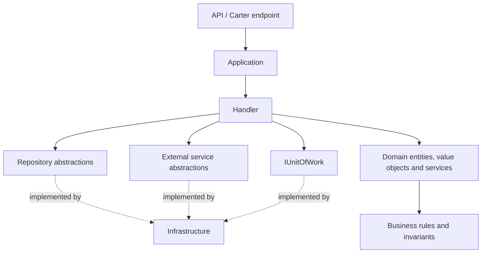
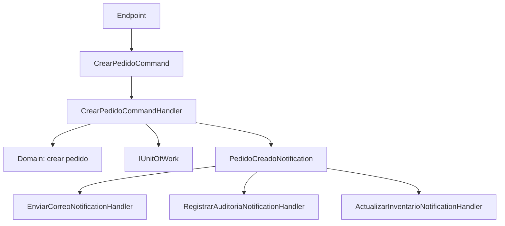

# Application, CQRS y validación

[Índice de documentación](../README.md) · [Adopción del proyecto](../adopcion-del-proyecto.md)

Define los casos de uso, la colaboración entre handlers y la validación de entradas.

<a id="s7"></a>

## Capa Application

`[NombreProyecto].Application` contiene los casos de uso y sus contratos
internos: Commands, Queries, resultados (`Result`) y abstracciones. Los
contratos de transporte HTTP pertenecen a API.

Estructura recomendada por funcionalidad:

```text
Application/
├── Abstractions/
│   ├── Persistence/
│   ├── Repositories/
│   │   └── IRepository.cs
│   ├── QueryServices/
│   ├── Security/
│   ├── Time/
│   └── Messaging/
├── Common/
│   ├── Behaviors/
│   ├── Exceptions/
│   ├── Extensions/
│   │   └── EnumExtensions.cs
│   ├── Mapping/
│   └── Models/
└── Features/
    └── [Feature]/
        ├── Commands/
        │   └── [UseCase]/
        │       └── [UseCase]Command.cs
        ├── Queries/
        │   └── [UseCase]/
        │       └── [UseCase]Query.cs
        ├── Mapping/
        │   └── [Feature]MappingConfig.cs
        ├── Results/
        │   └── [UseCase]Result.cs
        └── Validators/
```

Application DEBE definir abstracciones para servicios externos y persistencia.
Infrastructure implementa esas abstracciones.

Las abstracciones de consulta se ubican en `Application/Abstractions/QueryServices`.
Las abstracciones transversales
permanecen en `Application/Abstractions`. Los QueryHandlers coordinan lecturas
mediante esos contratos y devuelven resultados de Application. No construyen ni
ejecutan consultas EF Core y no reciben `IQueryable`, DbContext ni expresiones
del proveedor. Los criterios de lectura son valores o modelos propios de
Application; no se reutilizan contratos Request de API como filtros internos.


<a id="s9"></a>

## CQRS con martinothamar/Mediator

El proyecto usa
[`martinothamar/Mediator`](https://github.com/martinothamar/Mediator), no
MediatR.

Tipos recomendados:

- `ICommand<TResponse>` para cambios de estado;
- `IQuery<TResponse>` para lecturas;
- `INotification` para eventos internos;
- `ICommandHandler` para comandos;
- `IQueryHandler` para consultas;
- `INotificationHandler` para notificaciones;
- `IMediator.Send(...)` para enviar un comando o una consulta;
- `IMediator.Publish(...)` para publicar una notificación a cero o más
  consumidores.

Todos los handlers de CQRS DEBEN residir en la capa Application, junto al caso
de uso que implementan. Esta regla incluye `CommandHandler`, `QueryHandler` y
`NotificationHandler`, incluso cuando coordinan altas, modificaciones,
consultas, transacciones u otras operaciones de persistencia.

Cada Command o Query DEBE declararse en el mismo archivo que su handler
correspondiente. El archivo se nombra según el mensaje: `[UseCase]Command.cs`
contiene `[UseCase]Command` seguido de `[UseCase]CommandHandler`, y
`[UseCase]Query.cs` contiene `[UseCase]Query` seguido de
`[UseCase]QueryHandler`. Ambos tipos son declaraciones independientes bajo el
mismo namespace con ámbito de archivo; no se anidan uno dentro del otro.
NO se crean archivos separados `CommandHandler.cs` o `QueryHandler.cs`.
Esta regla es una excepción explícita a la convención de un tipo público por
archivo y no cambia la ubicación en Application. Los DTO HTTP, Results y
validators conservan sus archivos independientes. Los NotificationHandlers
conservan su organización por caso de uso; esta regla de archivo compartido
aplica a Commands y Queries.

Un handler PUEDE coordinar persistencia, pero solo depende de contratos
declarados en Application, como `IRepository<Usuario>`, `IUsuarioQueryService` e
`IUnitOfWork`. No puede depender de un `DbContext`, una implementación EF Core,
`IDbContextTransaction` ni una clase concreta de Infrastructure. Infrastructure
implementa esos contratos; Api se limita a recibir la solicitud y enviarla al
Mediator. Por tanto, no se permiten handlers CQRS en Domain, Infrastructure ni
Api.

El handler orquesta el caso de uso, pero NO implementa las reglas de negocio que
pertenecen al dominio. Su responsabilidad normal es:

1. recibir el `Command` o `Query` ya validado;
2. obtener los datos necesarios mediante abstracciones de Application;
3. coordinar repositorios y servicios externos;
4. invocar métodos de entidades, value objects o Domain Services;
5. persistir los cambios mediante repositorios e `IUnitOfWork`;
6. mapear y devolver el resultado del caso de uso definido en Application.



El handler PUEDE decidir el orden del flujo —cargar, invocar, persistir y
publicar—, pero expresiones como cálculo de tarifas, elegibilidad, cambios de
estado permitidos, cupos o restricciones operativas deben implementarse en
Domain. Un handler con múltiples condicionales que reproducen invariantes del
negocio es una señal de lógica de dominio mal ubicada.

<a id="tema-colaboracion-entre-handlers"></a>

### Colaboración entre handlers

Un handler NO DEBE depender directamente de otro handler ni invocarlo como un
servicio. Cada handler representa un caso de uso independiente y mantiene una
única responsabilidad. Quedan prohibidas dependencias como:

```text
CrearPedidoCommandHandler -> CrearClienteCommandHandler
Handler A -> Handler B -> Handler C -> Handler D
```

Los handlers solo se resuelven y ejecutan a través de Mediator. Si varios casos
de uso necesitan la misma lógica, esta se extrae según su naturaleza:

| Tipo de lógica compartida | Ubicación |
| --- | --- |
| Regla, cálculo o invariante de negocio | Entidad, value object o Domain Service |
| Orquestación reutilizable propia de Application | Application Service |
| Consulta especializada | Query Service definido como abstracción en Application |
| Persistencia | Repository y `IUnitOfWork` definidos en Application e implementados en Infrastructure |
| Integración externa | Abstracción en Application e implementación en Infrastructure |

Un handler PUEDE usar `IMediator.Send()` para ejecutar explícitamente otro
comando o consulta cuando el segundo caso de uso también tenga sentido de forma
independiente. Esta composición debe ser excepcional, poco profunda y estar
justificada; no se utiliza para evitar extraer lógica compartida. No se permiten
cadenas de handlers, dependencias circulares ni flujos cuya transacción,
autorización o comportamiento ante fallos resulte ambiguo.

Cuando una acción sea consecuencia de un hecho ya ocurrido y el emisor no
necesite conocer a los consumidores, se utiliza `INotification` con uno o más
`INotificationHandler`:



El `CrearPedidoCommandHandler` publica el hecho y no conoce ni inyecta los
handlers de correo, auditoría o inventario. Los `NotificationHandler` también
residen en Application y dependen de abstracciones, no de implementaciones de
Infrastructure.

Las notificaciones en proceso no equivalen a mensajería durable. Si un efecto
externo debe sobrevivir a fallos, reinicios o reintentos —por ejemplo, enviar un
correo después de confirmar una operación—, el handler registra un evento de
Outbox dentro de la misma transacción. Un Worker lo procesa de forma idempotente
después del commit. La estrategia de publicación y el manejo de errores deben
definir si los consumidores se ejecutan secuencialmente o en paralelo; no se
debe asumir orden entre `INotificationHandler`.

La ubicación obligatoria reúne el Command y su handler en el mismo archivo:

```text
Application/Features/Usuarios/Commands/CrearUsuario/
├── CrearUsuarioCommand.cs  # Command y CommandHandler
└── CrearUsuarioValidator.cs
```

Ejemplo de resultado en
`Application/Features/Recursos/Results/CrearRecursoResult.cs`:

```csharp
public sealed record CrearRecursoResult(
    Guid Id,
    string Nombre,
    decimal Valor,
    DateOnly Fecha,
    bool Activo);
```

Command y handler en
`Application/Features/Recursos/Commands/CrearRecurso/CrearRecursoCommand.cs`:

```csharp
public sealed record CrearRecursoCommand(
    string Nombre,
    decimal Valor,
    DateOnly Fecha) : ICommand<CrearRecursoResult>;

public sealed class CrearRecursoCommandHandler(
    IRepository<Recurso> repository,
    IUnitOfWork unitOfWork,
    IMapper mapper)
    : ICommandHandler<CrearRecursoCommand, CrearRecursoResult>
{
    public async ValueTask<CrearRecursoResult> Handle(
        CrearRecursoCommand command,
        CancellationToken cancellationToken)
    {
        var entity = Recurso.Crear(command.Nombre, command.Valor, command.Fecha);
        repository.Add(entity);
        await unitOfWork.SaveChangesAsync(cancellationToken);
        return mapper.Map<CrearRecursoResult>(entity);
    }
}
```

<a id="tema-paquetes"></a>

### Paquetes

```xml
<!-- Application -->
<PackageReference Include="Mediator.Abstractions" Version="3.0.*" />

<!-- API: instalar el generador solamente en el ejecutable exterior -->
<PackageReference Include="Mediator.SourceGenerator" Version="3.0.*">
  <PrivateAssets>all</PrivateAssets>
  <IncludeAssets>runtime; build; native; contentfiles; analyzers</IncludeAssets>
</PackageReference>
```

`Mediator.SourceGenerator` NO DEBE instalarse en cada capa del mismo artefacto.
Los handlers se registran mediante el código generado, no mediante Scrutor.

<a id="tema-pipeline-behaviors"></a>

### Pipeline behaviors

El pipeline puede contener, en orden:

1. correlación y logging;
2. validación FluentValidation;
3. autorización del caso de uso, si aplica;
4. métricas y tracing;
5. manejo transaccional cuando se adopte como behavior.

La API configura Mediator con lifetime `Scoped` cuando los handlers consumen
`DbContext`, tenant u otras dependencias scoped.

```csharp
builder.Services.AddMediator(options =>
{
    options.ServiceLifetime = ServiceLifetime.Scoped;
    options.PipelineBehaviors =
    [
        typeof(LoggingBehavior<,>),
        typeof(ValidationBehavior<,>)
    ];
});
```

<a id="s10"></a>

## Validación con FluentValidation

Cada request, comando o consulta con entrada externa DEBE tener un validador
cuando existan reglas de forma.

```csharp
public sealed class CrearRecursoValidator
    : AbstractValidator<CrearRecursoCommand>
{
    public CrearRecursoValidator()
    {
        RuleFor(x => x.Nombre)
            .NotEmpty()
            .MaximumLength(150);

        RuleFor(x => x.Valor)
            .GreaterThanOrEqualTo(0);
    }
}
```

FluentValidation valida estructura, formato y rangos. Las reglas que requieren
base de datos se ejecutan en el handler para evitar condiciones de carrera y
deben respaldarse con restricciones del modelo relacional.


## Guías relacionadas

- [Utilidades para enumeraciones](../desarrollo/enumeraciones.md)
- [Convenciones de código y tipos de datos](../desarrollo/convenciones-codigo.md)
- [Unit of Work y transacciones](unit-of-work.md)
