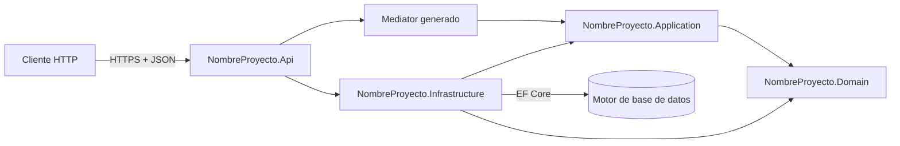
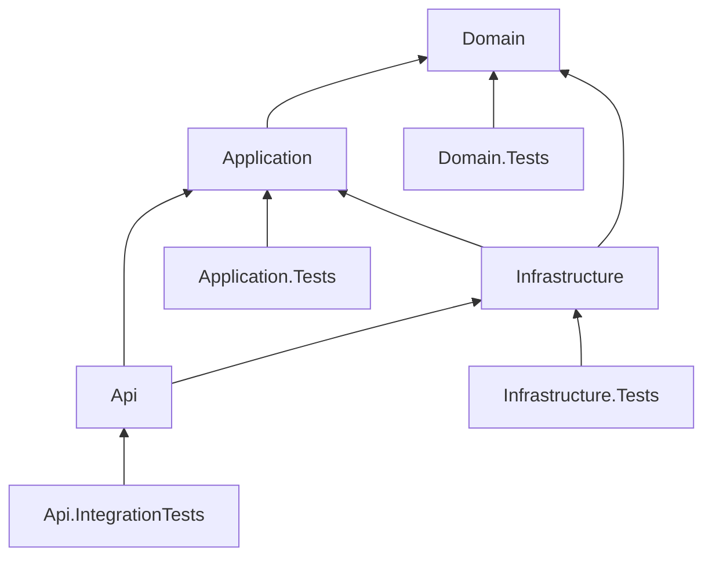
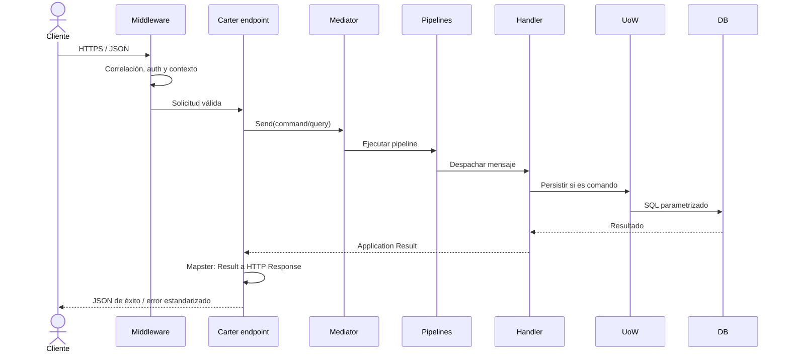

# Fundamentos y estructura de la solución

[Índice de documentación](../README.md) · [Adopción del proyecto](../adopcion-del-proyecto.md)

Define capas, referencias permitidas y el flujo de una solicitud.

<a id="s1"></a>

## Objetivo

Esta especificación define una base técnica uniforme para construir APIs REST
empresariales mantenibles, comprobables y preparadas para evolucionar.

La arquitectura establece:

- separación por capas;
- endpoints Minimal API organizados por funcionalidad con Carter;
- casos de uso con CQRS y Mediator generado en compilación;
- contratos inmutables mediante records;
- validación con FluentValidation;
- mapeo con Mapster;
- persistencia con Entity Framework Core;
- transacciones mediante Unit of Work;
- registro de dependencias con Scrutor;
- logging estructurado con Serilog;
- manejo centralizado de excepciones;
- autenticación y autorización configurables;
- pruebas automatizadas y reglas de calidad.


<a id="s4"></a>

## Vista arquitectónica



La dirección de dependencias apunta hacia el dominio. Domain y Application no
dependen del host web ni del proveedor de base de datos.

<a id="s5"></a>

## Estructura de la solución

```text
[NombreProyecto]/
├── [NombreProyecto].slnx
├── Directory.Build.props
├── Directory.Packages.props
├── .editorconfig
├── src/
│   ├── [NombreProyecto].Domain/
│   │   ├── Entities/
│   │   ├── Enums/
│   │   ├── ValueObjects/
│   │   ├── Events/
│   │   ├── Services/
│   │   └── Exceptions/
│   ├── [NombreProyecto].Application/
│   │   ├── Common/
│   │   │   └── Extensions/
│   │   └── Features/
│   │       └── [Feature]/
│   │           ├── Commands/
│   │           ├── Queries/
│   │           └── Results/
│   ├── [NombreProyecto].Infrastructure/
│   └── [NombreProyecto].Api/
│       └── Features/
│           └── [Feature]/
│               ├── [Feature]Module.cs
│               └── Contracts/
│                   ├── Requests/
│                   └── Responses/
├── tests/
│   ├── [NombreProyecto].Domain.Tests/
│   ├── [NombreProyecto].Application.Tests/
│   ├── [NombreProyecto].Infrastructure.Tests/
│   └── [NombreProyecto].Api.IntegrationTests/
└── docs/
    ├── architecture.md
    └── adr/
```

Referencias permitidas:



Una referencia que contradiga este diagrama DEBE justificarse con una ADR.


<a id="s16"></a>

## Flujo de una solicitud


