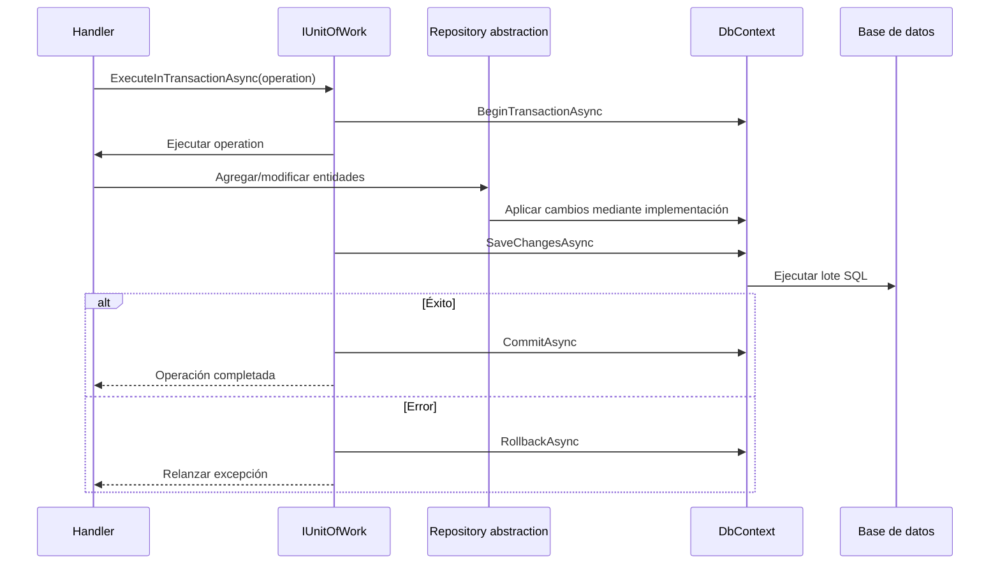

# Unit of Work y transacciones

[Índice de documentación](../README.md) · [Adopción del proyecto](../adopcion-del-proyecto.md)

Define el contrato y las responsabilidades transaccionales.

<a id="s14"></a>

## Unit of Work y transacciones

Todas las confirmaciones y transacciones DEBEN pasar por `IUnitOfWork`.

La interfaz reside en Application:

```csharp
public interface IUnitOfWork
{
    Task<int> SaveChangesAsync(
        CancellationToken cancellationToken = default);

    Task ExecuteInTransactionAsync(
        Func<CancellationToken, Task> operation,
        CancellationToken cancellationToken = default);
}
```

La implementación `EfUnitOfWork` reside en Infrastructure, implementa
`IScopedDependency` y comparte el mismo DbContext scoped con los repositorios.

Secuencia de una transacción:



Reglas:

- los handlers NO llaman directamente a `DbContext.SaveChangesAsync`;
- los handlers NO administran `IDbContextTransaction`;
- las consultas no abren transacciones explícitas;
- una operación con un solo guardado usa `IUnitOfWork.SaveChangesAsync`;
- una operación con varios pasos usa `ExecuteInTransactionAsync`;
- no se permiten commits parciales;
- no se inicia una transacción anidada sobre el mismo contexto;
- rollback no absorbe la excepción original;
- reintentos abarcan la operación completa;
- integraciones externas no transaccionales requieren Outbox u otra estrategia
  de consistencia, no una falsa transacción distribuida.
