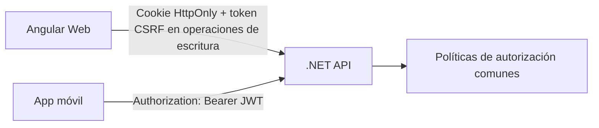

# Autenticación y autorización

[Índice de documentación](../README.md) · [Adopción del proyecto](../adopcion-del-proyecto.md)

Define cookies para Angular Web, JWT para móvil, antiforgery y políticas comunes.

## Autenticación y autorización

Esta sección se activa si el proyecto requiere identidad.

### Esquemas por cliente

La arquitectura base distingue el mecanismo de autenticación por cliente:

| Cliente | Credencial presentada a API | Esquema de ASP.NET Core |
| --- | --- | --- |
| Angular Web | Cookie de sesión HttpOnly emitida por el servidor. | Cookie Authentication, nombre `WebCookie`. |
| App móvil | Access token JWT en `Authorization: Bearer <token>`. | JWT Bearer, nombre `MobileBearer`. |

La cookie contiene un ticket protegido por Cookie Authentication o una referencia
a una sesión del servidor. El navegador no recibe el access token móvil para
guardarlo en localStorage/sessionStorage ni transforma la cookie de sesión en
un encabezado Bearer. OIDC/OAuth 2.0 pueden ser el mecanismo de inicio de sesión
y emisión de credenciales; no sustituyen la separación de transporte anterior.

### Sesión de Angular Web

- La cookie de autenticación DEBE usar `HttpOnly`, `Secure`, HTTPS y un ámbito
  mínimo. La convención base es `__Host-EduNet.Session` (reemplazar EduNet por
  `[NombreProyecto]`), `Path=/` y sin `Domain`; el prefijo `__Host-` requiere
  conservar esas condiciones. JavaScript no lee el contenido de la sesión.
- `SameSite=Lax` es la base para despliegues compatibles. Un flujo que requiera
  otro valor se define por proyecto; `SameSite=None` exige `Secure`. Se distingue
  origen de sitio: dos subdominios pueden ser de distinto origen y del mismo
  sitio. Preferir frontend y API bajo el mismo origen simplifica la integración.
- Para solicitudes a otro origen permitido, Angular utiliza credenciales
  (`withCredentials: true`) exclusivamente hacia la API confiable. API configura
  CORS con una lista exacta de orígenes y `AllowCredentials`; NO combina
  credenciales con `AllowAnyOrigin`. Una arquitectura entre sitios debe verificar
  las restricciones del navegador sobre cookies de terceros y definir un proxy
  del mismo origen si son incompatibles con la sesión.
- El servidor emite la cookie después de autenticar al usuario, renueva la
  identidad de sesión al iniciar sesión y define duración, inactividad y límite
  absoluto. Logout invalida la sesión y expira la cookie con su mismo ámbito;
  si se requiere revocación inmediata, se usa un registro de sesión o versión de
  seguridad comprobada por el servidor. Borrar la cookie no invalida por sí solo
  una copia del ticket ya emitido.
- Las réplicas comparten las claves de Data Protection y el nombre de aplicación
  cuando deban aceptar las mismas cookies; se protege, rota y conserva el key
  ring conforme a la vida útil de las sesiones. No se usa un key ring efímero en
  producción si las sesiones deben sobrevivir reinicios.

### Protección CSRF para cookies

Todas las operaciones HTTP que cambien estado autenticadas mediante cookie
DEBEN validar antiforgery del lado del servidor, incluidos `POST`, `PUT`,
`PATCH` y `DELETE`. También se protege el login web frente a login CSRF y el
logout web. `GET` y `HEAD` no cambian estado de negocio. HttpOnly, SameSite y CORS
son defensas complementarias; no sustituyen la validación del token CSRF.

El servidor proporciona un request token antiforgery asociado a la cookie
antiforgery mediante un endpoint de inicialización restringido a los orígenes
aprobados. Angular envía ese request token en `X-XSRF-TOKEN`. El token CSRF se
puede entregar en una respuesta o en una cookie legible por JavaScript; esa
cookie es distinta de la cookie de autenticación, que sigue siendo HttpOnly.
Después del login se obtiene un token antiforgery correspondiente a la nueva
identidad. El endpoint y sus respuestas no se cachean ni registran tokens.

En una API JSON con Carter/Minimal APIs, el proyecto DEBE implementar y probar
validación explícita de antiforgery, mediante middleware/filtro o
`IAntiforgery.ValidateRequestAsync`; no presume protección automática por
registrar servicios antiforgery. La validación ocurre después de resolver la
autenticación y antes de ejecutar el CommandHandler. Un token ausente o inválido
devuelve `400` con ApiErrorResponse y `traceId`, sin ejecutar el caso de uso.
En despliegues entre orígenes se configura explícitamente el envío del token
desde Angular; no se presupone que el interceptor XSRF lo añada a cualquier URL.

La excepción a antiforgery se limita a operaciones que se autentican
exclusivamente por Bearer y no aceptan credenciales ambientales por cookie.
Los endpoints públicos de escritura también definen su protección frente a
abuso; no se desactiva antiforgery globalmente para habilitar el cliente móvil.

### Access tokens de la app móvil

- La app envía JWT access tokens mediante `Authorization: Bearer`; API valida
  firma, algoritmo permitido, emisor, audiencia, expiración y vigencia. No acepta
  un ID token como access token, ni tokens en query strings o cookies para este
  esquema. Las claves de validación provienen de un emisor confiable.
- La app almacena credenciales sensibles con mecanismos seguros del sistema
  operativo. Access tokens tienen duración acotada; refresh tokens, si existen,
  utilizan rotación, detección de reutilización y revocación según el emisor.
  Logout revoca la sesión/refresh token cuando corresponda; se documenta si los
  access tokens existentes siguen siendo válidos hasta su expiración.
- Si se usa un proveedor OIDC/OAuth 2.0, el flujo móvil es Authorization Code
  con PKCE y navegador del sistema; no se distribuye un client secret en la app.
  Si el proyecto administra credenciales propias, documenta emisión, renovación,
  revocación y almacenamiento mediante servicios especializados.

### Selección de esquema y autorización

API registra explícitamente `WebCookie` y `MobileBearer`. Los endpoints
exclusivos del navegador exigen WebCookie; los exclusivos de móvil exigen
MobileBearer. Los endpoints de negocio compartidos usan una política/esquema
selector con reglas deterministas:

1. si existe `Authorization`, solo se admite formato Bearer y se evalúa
   MobileBearer; una cabecera inválida o token rechazado produce `401`, sin
   fallback a una cookie que estuviera presente;
2. sin `Authorization`, se evalúa WebCookie;
3. la escritura autenticada por WebCookie exige antiforgery; la autenticada
   exclusivamente por MobileBearer no usa la cookie como identidad alternativa.

No se selecciona el esquema por User-Agent, por un campo libre de DTO ni por una
afirmación del cliente de que es móvil. No se fusionan identidades de ambas
credenciales en la misma solicitud. Se definen políticas de login, logout y
renovación coherentes con cada esquema; el login web no entrega tokens móviles
y el flujo móvil no emite cookies de sesión web.

El contrato de `POST /api/sesion` es la excepción de envelope documentada en
[respuestas del API](../arquitectura/respuestas-api.md#tema-sesion). Se conserva
la cookie HttpOnly para Web y el JWT para móvil. El resultado de credenciales
inválidas es genérico, sin distinguir empresa inactiva de usuario inexistente.

Ambos esquemas producen una identidad normalizada para las políticas de
autorización comunes: identificador estable de usuario, permisos/roles y tenant
validado cuando aplique. La autenticación reside en API y sus adaptadores; los
casos de uso consumen abstracciones de identidad de Application. API ejecuta
`UseCors`, `UseAuthentication` y `UseAuthorization` en ese orden antes de los
endpoints; la validación antiforgery se integra después de autenticación y
autorización para las rutas correspondientes.

Las respuestas de autenticación y autorización de API son `401` y `403` con
ApiErrorResponse y `traceId`, nunca redirecciones a páginas HTML. Se configuran
los eventos de challenge/forbid de ambos esquemas o un componente central que
escriba ese contrato; `IExceptionHandler` no intercepta por sí solo todas las
respuestas de autenticación. Una respuesta Bearer `401` conserva
`WWW-Authenticate` sin revelar detalles sensibles del token.

En la ruta de sesión, los escritores respetan la metadata de respuesta directa
y devuelven el objeto seguro `{ "error": "..." }` con su estado HTTP; la
correlación se mantiene en `X-Trace-Id`. Esta excepción no elimina la validación
antiforgery, la protección de credenciales ni las políticas de autenticación.

Si el proyecto habilita API keys para rutas específicas, esas rutas declaran una
política exclusiva que valida la clave y resuelve la empresa en el servidor;
no utilizan el selector Cookie/Bearer ni aceptan una cookie como fallback a una
API key inválida. El alcance se define en [seguridad y multiempresa](seguridad-y-multiempresa.md).

Reglas comunes:

- autorización mediante políticas, no condicionales repetidos;
- secretos externos a control de versiones;
- HTTPS obligatorio;
- contraseñas con un algoritmo especializado como Argon2id o BCrypt;
- revocación o versionado de seguridad cuando se requiera invalidación
  inmediata.

La identidad autenticada se obtiene del contexto del servidor. No se confía en
identificadores sensibles enviados libremente por el cliente.

Referencias oficiales:

- [Autorización con esquemas específicos](https://learn.microsoft.com/en-us/aspnet/core/security/authorization/limitingidentitybyscheme?view=aspnetcore-10.0).
- [Protección antiforgery](https://learn.microsoft.com/en-us/aspnet/core/security/anti-request-forgery?view=aspnetcore-10.0).
- [CORS y credenciales](https://learn.microsoft.com/en-us/aspnet/core/security/cors?view=aspnetcore-10.0).
